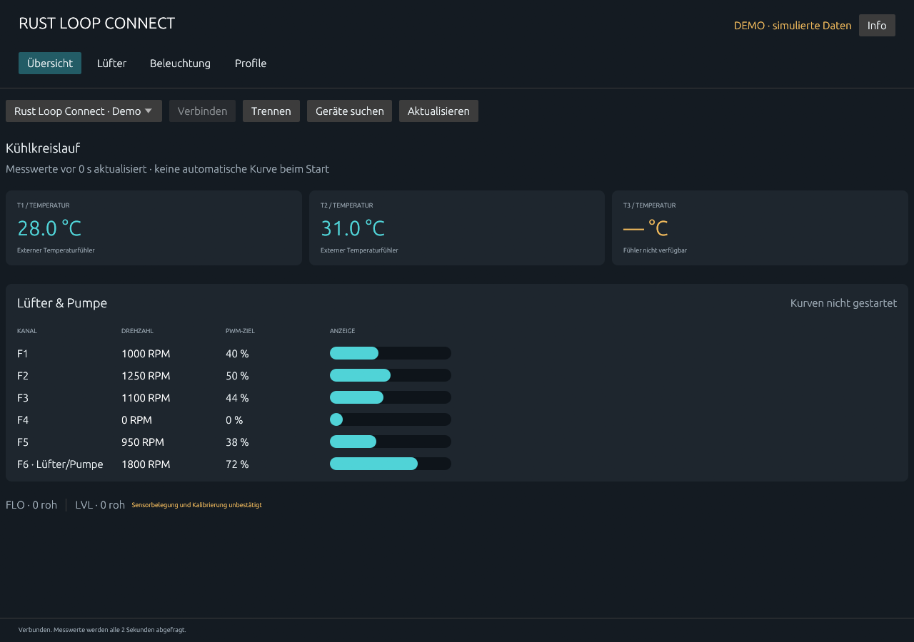
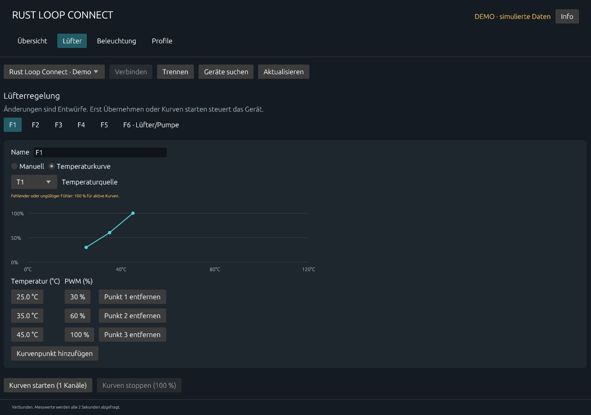
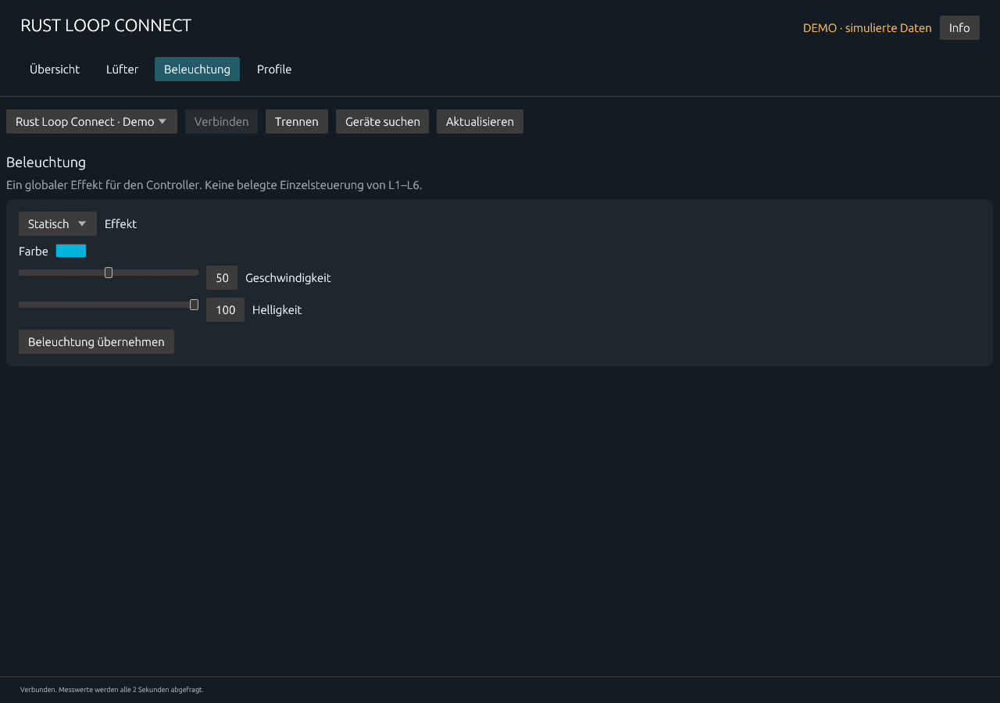

# Rust Loop Connect

**Rust Loop Connect** is an independent, open-source desktop application for monitoring and controlling USB cooling hardware on **Linux and Windows**. It currently supports the EK-Loop Connect controller. The [native Rust desktop application](desktop/README.md) provides a German dashboard, temperatures/RPM, manual PWM, temperature curves, global RGB effects and local profiles. Kubuntu is the first hardware test target.

The [Linux hwmon driver](linux/README.md) remains available for standard `fancontrol`, and the Python tool supplies portable diagnostics. Use one controller client at a time. No curve starts automatically, and physical fan calibration/Windows hardware acceptance remain pending; see the desktop validation record for the exact tested scope.

## Download 0.0.1

- [Linux x86_64](https://github.com/cbka/rust-loop-connect/releases/download/v0.0.1/rust-loop-connect-linux-x86_64)
- [Windows x86_64](https://github.com/cbka/rust-loop-connect/releases/download/v0.0.1/rust-loop-connect-windows-x86_64.exe)

On Linux, make the downloaded file executable with `chmod +x rust-loop-connect-linux-x86_64`, then run it. Windows users can start the `.exe` directly. See [setup and device permissions](desktop/README.md) and the [release notes](desktop/docs/releases/0.0.1.md).

## Screenshots

The following screenshots show the German interface in **demo mode with simulated readings**.

### Overview



### Temperature curves



### Lighting



## Credits and license

This project builds on **[Pavel Herrmann (pavelherr)'s ek-loop-connect repository](https://github.com/pavelherr/ek-loop-connect)**, including his Linux driver and reverse-engineered protocol documentation. Upstream baseline: [`5a6cf1f99b1b922ad21f4f6dff9d0ce99cc686cc`](https://github.com/pavelherr/ek-loop-connect/commit/5a6cf1f99b1b922ad21f4f6dff9d0ce99cc686cc). Original copyright and license notices are retained. Thank you, Pavel, for making this work available.

Distributed under **GPL-2.0-or-later**; see [LICENSE](LICENSE) and [NOTICE.md](NOTICE.md). This is an independent community project, not an official EK product.

## Current support

| Capability | State |
| --- | --- |
| Identify EK Connect and HID interface 0 | Verified on Linux |
| Query all six fan channels | Verified; current test device reports 0 RPM on each |
| Read configured PWM targets | Verified on Linux |
| Identify disconnected T1–T3 (`0xe7`) | Verified, including removal of the T2 probe |
| Read actual attached temperature probe | All three inputs exercised on Linux; T2-to-T3 probe move verified |
| Linux hwmon driver on kernel 7.0.0-42-generic | Build verification recorded in validation document |
| Physical fan speed changes | Not yet tested |
| Ubuntu fancontrol configuration | Requires installed driver, connected probes/fans and confirmed mapping |
| Windows Python/HIDAPI transport | Implemented experimental path; real Windows device test pending |
| Native Rust Linux/Windows GUI | Implemented; see desktop/ for exact validation |
| Windows Fan Control plugin | Separate future integration, not required by the Rust app |
| Global RGB effects | Implemented in the Rust desktop app; earlier script tests verified global effects |
| SW, EXT | Outside the implemented device controls |

## Desktop application

See [desktop/README.md](desktop/README.md) for native Linux/Windows builds, permissions, controls and profile behavior. Tagged releases publish native Linux and Windows binaries. Source and protocol work credit Pavelherr and OpenRGB; vendor binaries are not included.

## Quick start (Python diagnostics)

Read [Linux installation and fancontrol notes](linux/README.md) for the kernel integration. Use the diagnostic tool first if the kernel driver is **not** bound to interface 0:

```sh
python3 tools/ekloop.py list
python3 tools/ekloop.py status
```

`status` sends only query commands. It does not change PWM targets. On Linux it uses `hidraw` and Python's standard library. [Windows setup and limitations](docs/windows.md) describe the optional HIDAPI transport.

The VID/PID `0483:5750` is shared by unrelated products. Always also verify the product name **EK Connect** and interface 0. Do not grant access to all devices with that USB ID indiscriminately.

## Cooling behavior

The controller is reported to retain the last PWM setting when control software stops. No verified hardware watchdog is available. Running a controller process is required for a software temperature curve; a crash must not be assumed to restore cooling automatically. Confirm connected fan/probe mapping and suitable minimum/startup PWM before enabling a curve. Do not run `pwmconfig` unattended: its probing can stop fans.

Use only one controlling client at a time: kernel driver + fancontrol **or** the portable HID tool. EK software, OpenRGB and other HID clients can interfere with response routing. Never run both against the same interface simultaneously. Read [validation and remaining acceptance work](docs/VALIDATION.md).

## Development

```sh
python3 -m unittest discover -s tests -v
make -C linux
```

Build artifacts are excluded from version control. Tests run without hardware; actual device checks are recorded separately. See [PLAN.md](docs/PLAN.md) for the remaining milestones and [upstream protocol](docs/upstream-protocol.md) for the original wire description.
